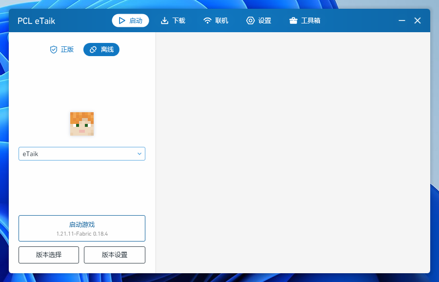
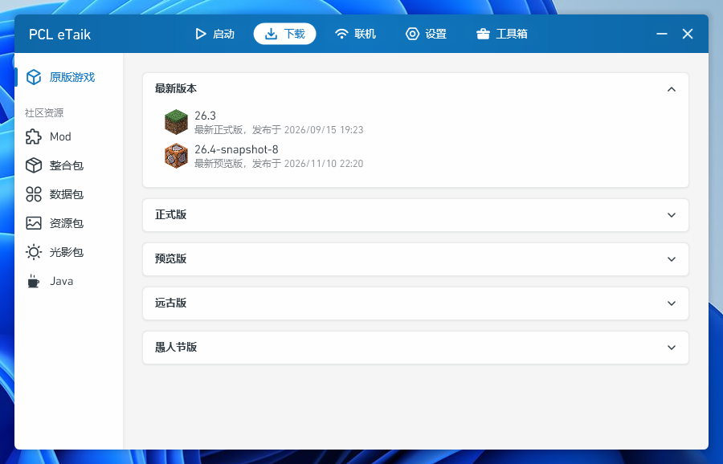
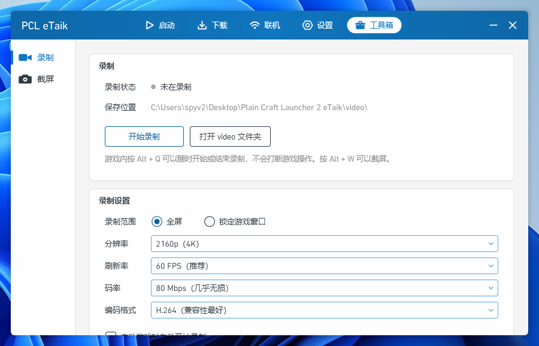
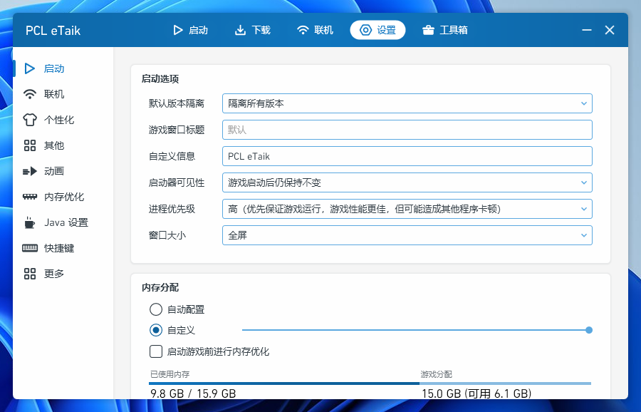
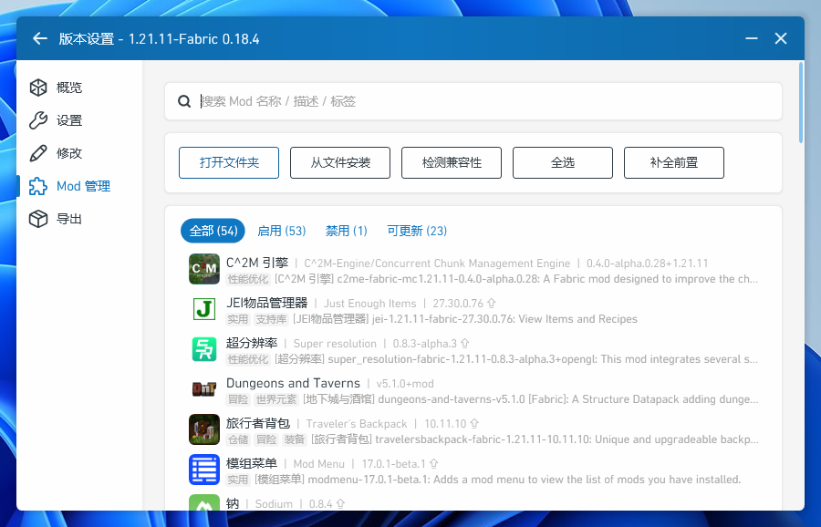

# PCL eTaik 3.0

基于 **Plain Craft Launcher 2** 的第三方修改版 Minecraft 启动器（Windows / WPF / VB.NET）。
当前版本 **3.0.0.0**。

> 普通用户请直接到 **Releases → v3.0** 下载成品，不需要编译本仓库。
>
> **推荐下载 `PCL-eTaik-3.0.zip`**，解压到任意文件夹即可运行，包内文件名已正确：
>
> | 包内文件 | 说明 |
> |---|---|
> | `Plain Craft Launcher 2 eTaik.exe` | 主程序（已签名，3.0.0.0） |
> | `Plain Craft Launcher 2 eTaik.exe.config` | 运行时配置（程序集绑定重定向），**必须与 exe 同名同目录** |
> | `联机包.zip` | 联机功能分体包，解压到 exe 同目录 |
>
> 若只需要更新联机组件，可单独下载 `PCL-eTaik-Online-Pack.zip`（内容即 `联机包.zip`）。
> 本仓库存放的是完整源码，供查阅与自行构建。
>
> 提示：GitHub 会把 Release 附件名中的空格自动替换为 `.`，因此不建议直接把裸 exe
> 作为独立附件——那样下载后名字会变成 `Plain.Craft.Launcher.2.eTaik.exe`，与
> `.exe.config` 不再匹配。请使用上面的压缩包。

## 3.0 主要功能

- 一键补全前置 Mod、Mod 兼容性检查、恢复原版游戏与 Java 下载
- 工具箱：**录屏**（Direct3D 11 桌面复制 + 硬件编码 + WASAPI 系统声音，默认 `Alt + Q`）、
  **截屏**（`Alt + W`，分辨率可调，图片保存到程序目录 `photo\`）
- 动画体系：独立的动画速度 / 动画细节 / 高级动画设置，切页动画可打断
- 主题与个性化、皮肤库 / 衣橱（多皮肤源、高清预览、拖拽排序）
- EasyTier 异地联机：无需公网 IP、无需登录，房间管理与虚拟局域网
- 内存优化：按「已用内存高于 N GB」触发，回收全进程工作集
- 品牌与视觉：蓝色六边形图标、启动画面、贴边提示条

## 界面预览

  

启动页：正版 / 离线切换、头像是当前皮肤、「自定义信息」显示在游戏窗口标题栏

<table>
<tr>
<td width="50%"></td>
<td width="50%"></td>
</tr>
<tr>
<td align="center">下载：原版 / 整合包 / Mod / 数据包 / 资源包 / 光影 / Java</td>
<td align="center">工具箱：录屏（含系统声音，可选 4K 60FPS）/ 截屏</td>
</tr>
<tr>
<td width="50%"></td>
<td width="50%"></td>
</tr>
<tr>
<td align="center">设置：启动选项、内存分配（按 GB 语义）、动画与个性化</td>
<td align="center">版本设置 · Mod 管理：一键补全前置、兼容性检测、启用/禁用与更新</td>
</tr>
</table>

  

录屏 / 截屏状态提示条：从屏幕边缘滑出，贴边不遮挡画面，不打断游戏操作

## 仓库结构

| 路径 | 内容 |
|---|---|
| `Plain Craft Launcher 2\` | 完整 VB.NET / WPF 工程（`.vbproj`、`.vb`、`.xaml`、`Images\`、`Resources\`） |
| `LICENCE.txt` | 上游《PCL 分发有限许可》与《PCL 存储库合理使用指南》全文 |
| `docs/images/` | 上图中的界面截图（README 预览用） |
| `BUILD.md` | 构建环境与方法 |
| `MANIFEST.txt` | 源码文件清单与 sha256，便于核对完整性 |

`bin\`、`obj\` 为编译产物，不纳入仓库；`Resources\EasyTier.zip` 是第三方联机分体包，
不属于源码，请从 Release 下载后放到程序目录。

## 构建

见 [BUILD.md](BUILD.md)。简要：Visual Studio 2022 + .NET Framework 4.8 目标包，
用 MSBuild 编译 `Plain Craft Launcher 2\Plain Craft Launcher 2.vbproj`（Release / AnyCPU）。
`Resources\*.dll` 为必需的第三方引用，已随仓库提供。

## 第三方凭据

源码中**不包含任何第三方密钥**：

- 微软登录 ClientId 默认留空，需要时设置环境变量 `PCL_MS_CLIENT_ID` 指向自行注册的 Azure 应用；
- CurseForge API Key 默认留空，需要时设置 `PCL_CURSEFORGE_API_KEY`；
- EasyTier 使用源码内置的公共中继配置，不含私有密钥。

## 许可与声明

本项目基于 [Plain Craft Launcher 2](https://github.com/Hex-Dragon/PCL2) 修改。
上游采用**《PCL 分发有限许可》**（见 `LICENCE.txt`），**并非 OSI 认证的开源许可证**：
该许可对分发与二次开发有明确限制。公开本仓库仅表示源码可被查阅，不代表授予超出上游许可的权利。
若您打算二次分发或商用，请先自行确认并遵守上游许可条款。

第三方组件：EasyTier、SharpDX、NAudio、Newtonsoft.Json、Ookii.Dialogs.Wpf、
Imazen.WebP、CacheCow、System.Net.Http.Formatting 等，各自遵循其原始许可证。

本项目与 Mojang / Microsoft、PCL 官方无关联。Minecraft 相关商标归其权利人所有。
